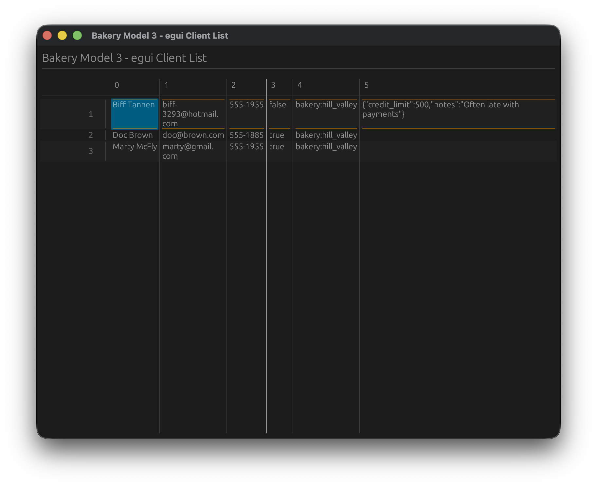
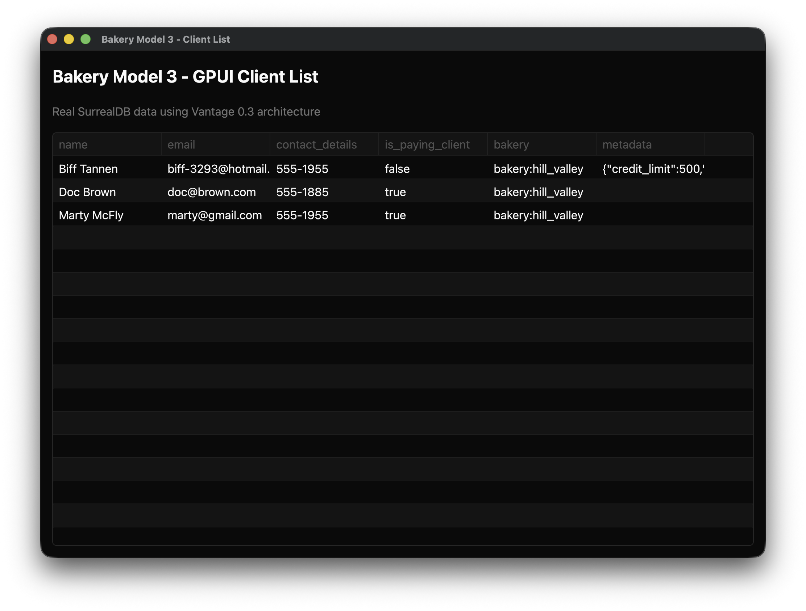
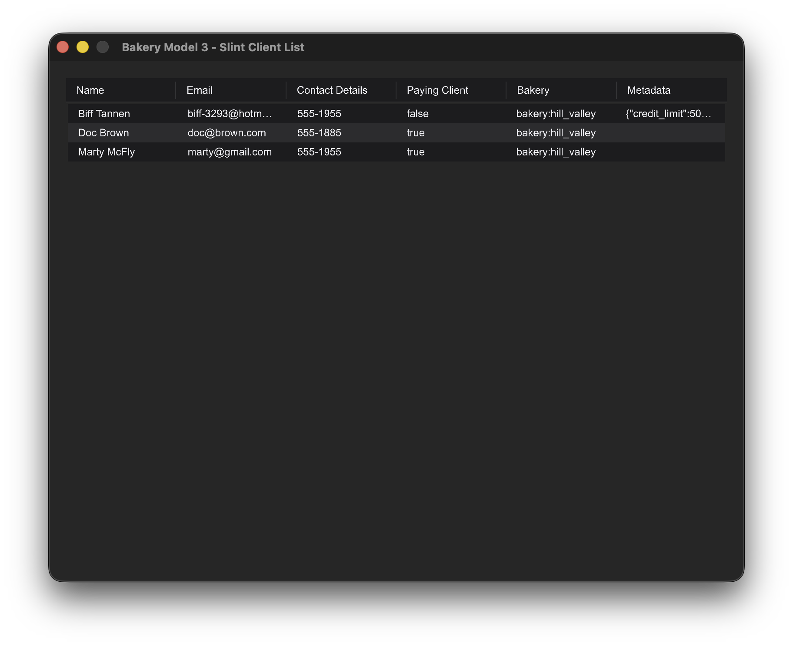
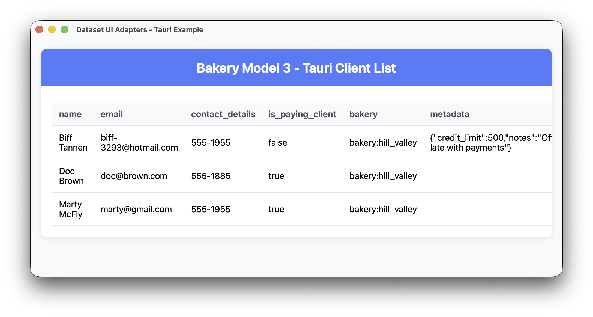
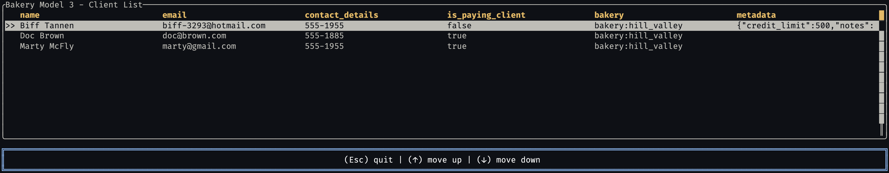
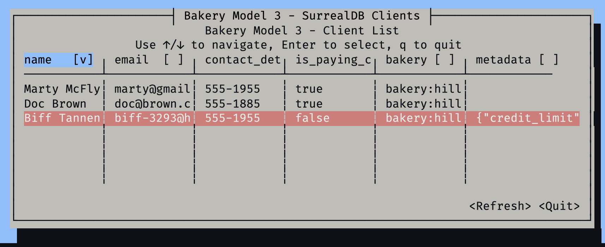

# Vantage UI Adapters

Universal table data adapters for major Rust UI frameworks. This crate bridges between data sources and UI framework table components, with intelligent caching and async data loading.

The package is named `dataset-ui-adapters` (import it as `dataset_ui_adapters`). It is not published; the `example_*` apps and `learn-6` use it through a path dependency.

## Screenshots

| Framework                                                                                               | Screenshot                          |
| ------------------------------------------------------------------------------------------------------- | ----------------------------------- |
| [**egui**](https://github.com/romaninsh/vantage/tree/main/example_egui) - Immediate mode GUI            |        |
| [**GPUI**](https://github.com/romaninsh/vantage/tree/main/example_gpui) - GPU-accelerated UI            |        |
| [**Slint**](https://github.com/romaninsh/vantage/tree/main/example_slint) - Declarative UI toolkit      |      |
| [**Tauri**](https://github.com/romaninsh/vantage/tree/main/example_tauri) - Web-based desktop apps      |      |
| [**Ratatui**](https://github.com/romaninsh/vantage/tree/main/example_tui) - Terminal UI framework       |          |
| [**Cursive**](https://github.com/romaninsh/vantage/tree/main/example_cursive) - Terminal UI with tables |  |

## Quick Start

Add to your `Cargo.toml`:

```toml
[dependencies]
dataset-ui-adapters = { path = "../vantage-ui-adapters", features = ["egui"] }
bakery_model3 = { path = "../bakery_model3" }
tokio = { version = "1.0", features = ["macros", "rt-multi-thread"] }
```

Example usage:

```rust
use bakery_model3::{Client, connect_surrealdb, surrealdb};
use dataset_ui_adapters::{egui_adapter::EguiTable, TableStore, VantageTableAdapter};

#[tokio::main]
async fn main() -> Result<(), Box<dyn std::error::Error>> {
    // Connect to SurrealDB and build a Vista over the client table
    connect_surrealdb().await?;
    let db = surrealdb();
    let vista = db
        .vista_factory()
        .from_table(Client::surreal_table(db.clone()))?;

    // Create adapter and table
    let client_table_adapter = VantageTableAdapter::new(vista).await;
    let store = TableStore::new(client_table_adapter);
    let table = EguiTable::new(store).await;

    // Use in your UI framework...
    Ok(())
}
```

## Architecture

- **Vista**: A data source (e.g. Clients from SurrealDB), wrapped by `VantageTableAdapter`
- **UI Adapter**: Bridge layer with caching and async loading
- **UI Framework**: Any supported framework (egui, GPUI, Slint, etc.)

## Supported Frameworks

| Framework   | Type        | Columns | Rows | Auto-refresh | Editing |
| ----------- | ----------- | ------- | ---- | ------------ | ------- |
| **egui**    | Desktop GUI | ✅      | ✅   | ❌           | ❌      |
| **GPUI**    | GPU Desktop | ✅      | ✅   | ❌           | ❌      |
| **Slint**   | Native UI   | ✅      | ✅   | ❌           | ❌      |
| **Tauri**   | Web Desktop | ✅      | ✅   | ❌           | ❌      |
| **Ratatui** | Terminal    | ✅      | ✅   | ❌           | ❌      |
| **Cursive** | Terminal    | ✅      | ✅   | ❌           | ❌      |

## Framework Usage

In each snippet, `vista` is built as in the Quick Start above.

### egui

```rust
#[tokio::main]
async fn main() -> Result<(), Box<dyn std::error::Error>> {
    let client_table_adapter = VantageTableAdapter::new(vista).await;
    let store = TableStore::new(client_table_adapter);
    let table = EguiTable::new(store).await;

    let app = TableApp { table };
    eframe::run_native("Client List", options, Box::new(|_cc| Ok(Box::new(app))))?;
    Ok(())
}
```

### GPUI

`GpuiTableDelegate` implements gpui-component's `TableDelegate`, so it goes into a `TableState` and renders with `DataTable`. The app itself depends on `gpui_platform` and `gpui-component`, as `example_gpui` does:

```rust
fn main() {
    gpui_platform::application().run(move |cx| {
        gpui_component::init(cx);

        cx.spawn(async move |cx| {
            let client_table_adapter = VantageTableAdapter::new(vista).await;
            let store = TableStore::new(client_table_adapter);
            let delegate = GpuiTableDelegate::new(store);

            cx.open_window(WindowOptions::default(), |window, cx| {
                let state = cx.new(|cx| TableState::new(delegate, window, cx));
                let view = cx.new(|cx| TableApp::new(state, window, cx));
                cx.new(|cx| Root::new(view, window, cx))
            })?;
            Ok::<_, anyhow::Error>(())
        })
        .detach();
    });
}

// in TableApp::render:
// .child(DataTable::new(&self.state).stripe(true).bordered(true))
```

### Slint

```rust
#[tokio::main]
async fn main() -> Result<(), Box<dyn std::error::Error>> {
    let client_table_adapter = VantageTableAdapter::new(vista).await;
    let store = TableStore::new(client_table_adapter);
    let table = SlintTable::new(store).await;

    let app = MainWindow::new()?;
    // example_slint copies the rows of `table.as_model_rc()` into
    // StandardListViewItem models for its `table-rows` property
    app.set_table_rows(rows);
    app.run()?;
    Ok(())
}
```

### Tauri

```rust
#[tokio::main]
async fn main() {
    let client_table_adapter = VantageTableAdapter::new(vista).await;
    let store = TableStore::new(client_table_adapter);
    let table = TauriTable::new(store).await;

    tauri::Builder::default()
        .manage(table)
        .invoke_handler(tauri::generate_handler![get_table_data, get_table_columns])
        .run(tauri::generate_context!())
        .expect("error while running tauri application");
}
```

### Ratatui

```rust
#[tokio::main]
async fn main() -> Result<(), Box<dyn std::error::Error>> {
    let client_table_adapter = VantageTableAdapter::new(vista).await;
    let store = TableStore::new(client_table_adapter);
    let mut adapter = RatatuiTableAdapter::new(store);
    adapter.refresh_data().await;

    loop {
        terminal.draw(|f| {
            let table = adapter.create_table();
            f.render_stateful_widget(table, f.area(), adapter.state_mut());
        })?;

        if let Event::Key(key) = event::read()? {
            match key.code {
                KeyCode::Char('q') | KeyCode::Esc => return Ok(()),
                KeyCode::Down => adapter.next_row(),
                KeyCode::Up => adapter.previous_row(),
                _ => {}
            }
        }
    }
}
```

### Ratatui over a Scenery

The `ratatui` feature also enables `ratatui_dio::SceneryTable`, which takes a `vantage-diorama` `TableScenery` instead of a `TableStore`. It owns the terminal loop, renders only the visible rows, repaints when the scenery changes, and can pin `ValueScenery` readouts to the status bar. `learn-6` uses it:

```rust
use dataset_ui_adapters::ratatui_dio;

ratatui_dio::SceneryTable::new(scenery)
    .with_column("FILENAME", "Key", 0) // width 0 = flexible fill
    .with_column("SIZE", "Size", 10)
    .with_status_value("total rows", totals)
    .run()
    .await?;
```

### Cursive

```rust
#[tokio::main]
async fn main() -> Result<(), Box<dyn std::error::Error>> {
    let client_table_adapter = VantageTableAdapter::new(vista).await;
    let store = TableStore::new(client_table_adapter);
    let app = CursiveTableApp::new(store).await?;
    app.run()?;
    Ok(())
}
```

## Data Integration

The adapters work with any data source that implements the `DataSet` trait. The included `VantageTableAdapter` wraps any `Vista`, so it works with every persistence that has a vista factory. It loads all rows when constructed and serves them from memory:

```rust
// Client table from bakery_model3, as a Vista
let db = surrealdb();
let vista = db
    .vista_factory()
    .from_table(Client::surreal_table(db.clone()))?;
let client_table_adapter = VantageTableAdapter::new(vista).await;
let store = TableStore::new(client_table_adapter);
```

## Features

- **Async Data Loading**: Non-blocking data fetching
- **Smart Caching**: Automatic caching with configurable page sizes
- **Real Database Integration**: Works with any Vista (the examples use SurrealDB)
- **Cross-Framework**: Same data layer works across all UI frameworks
- **Type Safety**: Full Rust type safety throughout the stack

## Examples

Run the examples to see each framework in action:

```bash
# Desktop examples
cd example_egui && cargo run
cd example_gpui && cargo run
cd example_slint && cargo run
cd example_tauri && cargo run dev

# Terminal examples
cd example_tui && cargo run
cd example_cursive && cargo run
```

## Requirements

- SurrealDB server running on `ws://localhost:8000`
- Rust 1.88+ (edition 2024; the Vantage crates use let chains)
- UI framework dependencies (installed automatically with features)

### Setting up SurrealDB

The `vantage-surrealdb` crate provides setup scripts to get you started quickly:

```bash
cd vantage-surrealdb/scripts

# Start SurrealDB server (Docker)
./start.sh

# Populate with sample data
./ingress.sh
```

This will start SurrealDB on `ws://localhost:8000` and populate it with the bakery model data (clients, orders, products, etc.) that all the UI examples use.

## Contributing

1. Each framework adapter follows the same async loading pattern
2. All examples use the same `bakery_model3` data source
3. No mock data - all adapters work with real SurrealDB data
4. Maintain consistent API across frameworks where possible

## License

MIT License - see LICENSE file for details.
